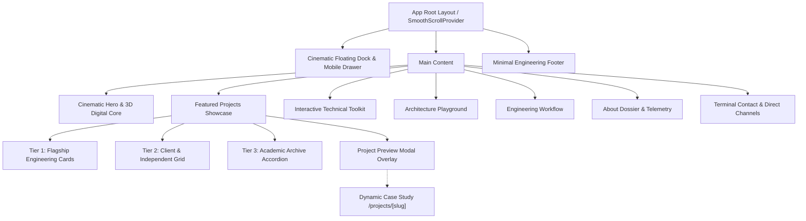

# CINEMATIC PORTFOLIO DESIGN SYSTEM & ARCHITECTURE SPECIFICATION

> **Brand:** MOHAMED ELBEEK — DIGITAL ENGINEERING  
> **Positioning:** Full-Stack Developer & Backend-Focused Engineer  
> **Concept:** FROM PIXELS TO PRODUCTION  
> **Core Message:** *"I build complete digital products — from engaging user interfaces to secure backend systems and reliable infrastructure."*

---

## 1. Visual Identity & Design Tokens

The visual language establishes an authoritative, cinematic engineering aesthetic. It avoids generic gaming neon, purple gradients, and superficial glassmorphism in favor of restrained architectural depth, dark navy foundations, and electric/cyan illumination.

### Color Palette

| Token | Hex / Value | Semantic Role |
|---|---|---|
| `--bg-deep-black` | `#080B12` | Canvas ground, terminal backgrounds, base body background |
| `--bg-midnight-navy` | `#0C1424` | Primary cards, floating docks, navigation drawer background |
| `--bg-elevated-navy` | `#111C33` | Hover states, active layer cards, elevated surface elevations |
| `--accent-electric` | `#2563EB` | Primary CTA buttons, key highlight accents, active tab indicators |
| `--accent-electric-hover` | `#3B82F6` | Interactive hover highlights, glowing borders |
| `--accent-neon-cyan` | `#38BDF8` | Technical badges, active telemetry indicators, code labels |
| `--text-primary` | `#F8FAFC` | Headings, primary high-contrast content, white labels |
| `--text-secondary` | `#94A3B8` | Body paragraphs, descriptive text, secondary navigation links |
| `--text-tertiary` | `#64748B` | Monospace tags, metadata notes, timestamp labels |
| `--text-muted` | `#475569` | Subdued borders, inactive indicators |
| `--border-subtle` | `rgba(148, 163, 184, 0.08)` | Standard card borders, divider lines |
| `--border-medium` | `rgba(148, 163, 184, 0.14)` | Elevated card perimeters, modal frames |
| `--border-accent` | `rgba(37, 99, 235, 0.30)` | Active card highlights, focused element borders |
| `--border-cyan` | `rgba(56, 189, 248, 0.25)` | Technical pill borders, telemetry frames |

### Typography System

- **Display Headings:** `Space Grotesk` (Google Font, sans-serif display). Geometric, technical, punchy, high-impact uppercase tracking for headlines and section titles.
- **Body & Prose:** `Inter` (Google Font, sans-serif). Highly legible, neutral, balanced letter-spacing for paragraphs, descriptions, and lists.
- **Technical & Code:** `JetBrains Mono` (Google Font, monospace). Purpose-built for code snippets, telemetry tags, status badges, and architecture steps.

### Blueprint Textures & Atmospheric Glows

- `.engineering-grid`: 40px × 40px subtle technical coordinate grid.
- `.engineering-grid-dense`: 20px × 20px precision telemetry grid for inspection panels.
- `.gradient-radial-hero`: Radial blue atmosphere centered at top-hero to create cinematic depth.
- `.glow-electric` / `.glow-cyan`: Box-shadow diffuse glows for interactive elements.

---

## 2. Component Hierarchy & Architectural Structure

---

## 3. Section Specifications

### A. Cinematic Navigation Dock (`Navbar.tsx`)
- **Dock Layout:** Floating pill pinned to viewport top with 85% opacity backdrop-blur glass.
- **Scroll Tracking:** Automatic scroll-spy highlighting the active section based on IntersectionObserver thresholds.
- **Items:** Home, Work, Expertise, Engineering, Workflow, About, Contact, Resume PDF.
- **Mobile Drawer:** Accessible slide-over drawer with staggered link reveals, Escape key listener, and body scroll lock.

### B. Cinematic Hero & Digital Engineering Core (`Hero.tsx` + `DigitalCore.tsx`)
- **Headline:** `FROM PIXELS TO PRODUCTION.` with electric-to-cyan gradient text.
- **Interactive 3D Core:** 4-layer stacked architectural visualization:
  1. Frontend / Interface Layer (Next.js, React, Tailwind, Accessible UI)
  2. Backend / API Gateway Layer (NestJS, Node.js, JWT, Rate Limiting, OpenAPI)
  3. Business Logic & Services (Clean Architecture, Transaction Boundaries, Stripe)
  4. Database & Persistence Layer (PostgreSQL, Prisma ORM, MongoDB, ACID Integrity)
- **Telemetry Inspector:** Clicking any layer updates the real-time specifications panel with metrics, responsibilities, and stack details.
- **3D Tilt Interaction:** Perspective-based interactive tilt tracking pointer movement with smooth easing and non-WebGL SVG/CSS fallback.

### C. Reusable Project Presentation System (`FeaturedProjects.tsx`, `ProjectCard.tsx`, `ProjectPreviewOverlay.tsx`)
- **Tier 1 (Featured Engineering):**
  - `01. E-Commerce Platform` (Flagship Full-Stack with NestJS, PostgreSQL, Prisma, Stripe, Angular)
  - `02. LexaGuide` (Graduation Project with 48+ endpoints, JWT rotation, and legal consultations)
- **Tier 2 (Client & Independent Work):**
  - `03. Ahmed Elbeek Company System` (Commissioned business software with synthetic data safeguards)
  - `04. Sakan Al-Arish` (Independent student accommodation product)
  - `05. Minimal Be Creative` (Client commercial website)
- **Tier 3 (Earlier Work):**
  - `06. Tech E-Commerce Web Application` (ASP.NET MVC in collapsible archive)
- **Preview Overlay Interaction:**
  - Clicking "Preview" opens an accessible full-screen modal with visual cover, stack pills, overview, and "Explore Case Study" action.
  - Supports Escape key to close, click outside, and focus trapping.

### D. Dynamic Generic Case Study Engine (`/projects/[slug]/page.tsx` + `GenericCaseStudyView.tsx`)
- Fully integrated with Next.js 16 dynamic routing (`params: Promise<{ slug: string }>`).
- Pre-rendered statically at build time via `generateStaticParams()`.
- Reusable modular layout: Hero, Metadata, Architecture Matrix tabs (Stack vs. Highlights), Blueprint Canvas wireframe, and Prev/Next project navigation.
- Preserves existing `/projects/ecommerce` static route.

### E. Interactive Technical Toolkit (`TechnicalToolkit.tsx`)
- 6 Category Filters: Frontend, Backend, Databases, Architecture & Security, Integrations, DevOps & Testing.
- Interactive technology cards trigger real-time updates to the side telemetry panel with:
  - Technical purpose & category
  - Architectural application in Mohamed's projects
  - Engineered capabilities checklist
  - Direct links to associated production projects

### F. Interactive Engineering Playground (`EngineeringPlayground.tsx`)
- 7-Stage Request Lifecycle: Client &rarr; Frontend &rarr; API Gateway &rarr; Controller &rarr; Business Logic &rarr; Database &rarr; Response.
- Interactive flow conduit with animated glowing data packets.
- Real-world production code snippets for every stage (Zod validation, NestJS guards, Prisma `$transaction` stock queries, standard JSON responses).

### G. Engineering Workflow (`EngineeringWorkflow.tsx`)
- 6-Stage Journey: 01. Understand &rarr; 02. Architect &rarr; 03. Design &rarr; 04. Engineer &rarr; 05. Validate &rarr; 06. Deploy.
- Detailed deep-dive inspector with key objectives, deliverables, and Mohamed's architectural rule callouts.

### H. About Dossier (`About.tsx`)
- Professional identity section preserving all verified facts:
  - B.Sc. in Information Technology, Sinai University, June 2026
  - GPA 3.09 / 4.0 (Very Good)
  - Location: Cairo, Egypt
- Verified developer profiles (GitHub, LinkedIn) and official CV download.
- No fake portrait or unverified claims.

### I. Terminal Contact Section (`Contact.tsx`)
- Command-line inspired terminal layout (`$ cat channels.json`).
- Fully functional clipboard copy for email (`mohamed.elbeek88@gmail.com`) with instant "Copied!" visual feedback.
- Direct external links to WhatsApp, LinkedIn, GitHub, and CV PDF.

### J. Footer (`Footer.tsx`)
- Minimalist engineering footer with clean copyright, back-to-top shortcut, and external profile anchors.

---

## 4. Motion Principles & Accessibility

- **Lenis Smooth Scroll:** Provides fluid vertical momentum scrolling, disabled automatically if `prefers-reduced-motion` is detected.
- **GSAP & ScrollTrigger:** Drives section entrance choreography and scroll-linked timeline progressions.
- **Framer Motion Micro-Interactions:** Powers layout card transitions and `<SectionReveal>` viewports.
- **WCAG 2.1 AA Compliance:** High contrast ratios, 44px+ minimum touch targets, visible keyboard focus indicators (`outline: 2px solid var(--accent-electric)`), accessible skip links, and semantic HTML5 landmarks throughout.
