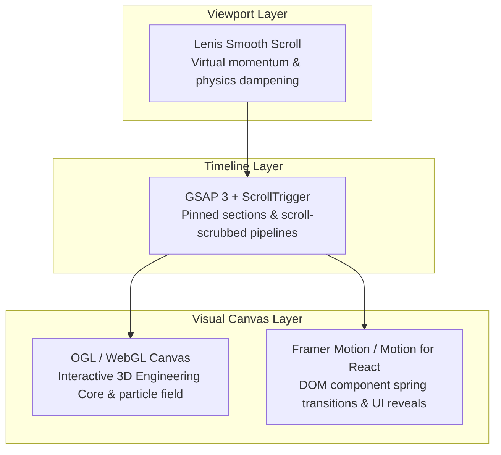

# PORTFOLIO EXPERIENCE BLUEPRINT
## Cinematic Digital Engineering Experience — Architecture & Implementation Master Plan

**Developer Brand:** MOHAMED ELBEEK — DIGITAL ENGINEERING  
**Core Creative Concept:** *FROM PIXELS TO PRODUCTION.*  
**Primary Positioning:** Full-Stack Developer | Backend-Focused Engineer  
**Git Branch:** `feat/cinematic-portfolio-redesign`  
**Base Commit:** `80c66ed` (`feat: complete personal portfolio website` on `main`)  
**Target Live Production:** [https://portfolio-alpha-liard-14.vercel.app/](https://portfolio-alpha-liard-14.vercel.app/)  
**Status:** Approved Master Implementation Blueprint  

---

## 1. Executive Vision & Creative Direction

This blueprint defines the end-to-end user experience, technical architecture, visual design system, and component engineering for the complete redesign of Mohamed Elbeek's personal developer portfolio.

```
       ┌─────────────────────────────────────────────────────────────┐
       │             MOHAMED ELBEEK — DIGITAL ENGINEERING            │
       │                 "FROM PIXELS TO PRODUCTION"                 │
       │                                                             │
       │   Full-Stack Developer  │  Backend-Focused Software Engineer │
       └─────────────────────────────────────────────────────────────┘
                                      │
           ┌──────────────────────────┴──────────────────────────┐
           ▼                                                     ▼
┌─────────────────────────────┐               ┌─────────────────────────────┐
│      CINEMATIC VISUALS      │               │     BACKEND RIGOR & DATA    │
│  - Deep Black & Midnight    │               │  - Clean Architecture       │
│  - Electric Blue & Neon Cyan│               │  - Transactional Integrity  │
│  - 3D Interactive WebGL Core│               │  - Concurrency Resilience   │
│  - Smooth Inertial Scrolling│               │  - 48+ REST API Endpoints   │
└─────────────────────────────┘               └─────────────────────────────┘
```

### Approved Creative Axioms

1. **Cinematic Immersion with High Performance:** The interface feels like a high-end command center or a next-generation engineering terminal. Black space is not empty—it has depth, subtle atmospheric grain, and ambient glowing cyan/electric blue radiation.
2. **Backend Engineering Primacy:** While the frontend is visually stunning, the content never loses sight of Mohamed’s core expertise: robust APIs, transactional database integrity, authentication lifecycles, and production reliability.
3. **Strict Data Confidentiality & Integrity:** Commissioned business projects (such as the Ahmed Elbeek Company System) strictly present synthetic, sanitized demo data. Independent products (such as Sakan Al-Arish) are accurately categorized without false freelance claims.
4. **Zero-Fluff, Production-Verified Metrics:** All technical claims are anchored in verified engineering proofs (e.g., 48+ REST endpoints, SHA-256 token rotation, atomic database updates).

---

## 2. Updated Project Taxonomy & Hierarchy

In accordance with the updated project priorities, all portfolio projects are organized into three clear, visually distinct tiers:

```mermaid
flowchart TD
    subgraph Tier 1: Featured Engineering Projects
        P1["01. E-Commerce Platform<br/><b>Flagship Full-Stack Engineering</b><br/>NestJS · PostgreSQL · Prisma · Stripe · Docker · Angular"]
        P2["02. LexaGuide<br/><b>Graduation Project (Grade A+)</b><br/>Node.js · Express · MongoDB · Mongoose · JWT · Zod · Cloudinary"]
    end

    subgraph Tier 2: Client & Independent Work
        P3["03. Ahmed Elbeek Company System<br/><b>Commissioned Business Software</b><br/>Enterprise Operations & Synthetic Data Architecture"]
        P4["04. Sakan Al-Arish<br/><b>Independent Accommodation Platform</b><br/>Student Housing Discovery & Listing Engine"]
        P5["05. Minimal Be Creative<br/><b>Client Commercial Website</b><br/>HTML5 · CSS3 · Modern JavaScript · Swiper · AOS"]
    end

    subgraph Tier 3: Earlier Work & Archive
        P6["06. Tech E-Commerce Web Application<br/><b>Academic MVC Application</b><br/>ASP.NET MVC · C# · SQL Server"]
    end

    Tier 1 -->|Flagship 3D Showcase| H1[Primary Visual Focus]
    Tier 2 -->|Separate Distinct Grid| H2[Client / Commercial Focus]
    Tier 3 -->|Collapsible Archive| H3[Historical Baseline]
```

### Tier Specifications

| Tier | Projects Included | Visual Treatment | Routing & Detail Level |
|---|---|---|---|
| **Tier 1: Featured Engineering Projects** | 01. E-Commerce Platform<br/>02. LexaGuide | Maximum visual weight: large 3D tilt cards, architecture layer badges, live telemetry indicators, and primary CTAs. | Dedicated deep-dive case studies (`/projects/ecommerce-platform`, `/projects/lexaguide`). |
| **Tier 2: Client & Independent Work** | 03. Ahmed Elbeek Company System<br/>04. Sakan Al-Arish<br/>05. Minimal Be Creative | Distinctive multi-column layout with high-contrast badge differentiation ("Commissioned Business System" vs. "Independent Product" vs. "Client Commercial Site"). | Rich preview modal or dedicated overview page with strict synthetic data notices. |
| **Tier 3: Earlier Work & Archive** | 06. Tech E-Commerce Web Application | Compact, minimalist row inside an expandable "Archived Engineering Works" accordion to preserve focus on modern capabilities. | In-row technical summary with historical stack badges. |

---

## 3. Complete Information Architecture & User Journey

### Global Page Layout

The portfolio operates as a unified cinematic single-page application supported by dynamic deep-dive project case study routes:

```
[00. Dynamic Canvas Background (WebGL Shaders + Particle Grid)]
[01. Floating Glass Navigation Dock (Telemetry, Anchors, CV, Audio/Motion Switch)]
  │
  ├── [02. Cinematic Hero Section]
  │     ├── Terminal Telemetry Status Pill
  │     ├── Dramatic Typographic Display ("FROM PIXELS TO PRODUCTION")
  │     ├── Positioning Subtitle (Full-Stack | Backend-Focused)
  │     ├── Interactive 3D WebGL Engineering Visual (Rotatable Architecture Node Core)
  │     └── Primary CTAs ("Explore Systems", "Command Center", "Download CV")
  │
  ├── [03. Selected Work: Flagship Engineering Projects (Tier 1)]
  │     ├── 01. E-Commerce Platform (Clean Architecture, Concurrency, Stripe)
  │     └── 02. LexaGuide (48+ Endpoints, Auth Lifecycle, Team Project A+)
  │
  ├── [04. Client & Independent Work (Tier 2)]
  │     ├── 03. Ahmed Elbeek Company System (Commissioned Enterprise System)
  │     ├── 04. Sakan Al-Arish (Independent Student Housing Platform)
  │     └── 05. Minimal Be Creative (Commercial Frontend Client Site)
  │
  ├── [05. System Blueprint: Request Lifecycle Pipeline ("How I Build")]
  │     └── Interactive 6-Stage Scrubbable Pipeline (Client → REST API → Controller → Service → Repository → DB)
  │
  ├── [06. Engineering Perspectives ("Behind the Interface")]
  │     └── 8 Interactive Architectural Radar Cards (Data Integrity, Security, Concurrency, etc.)
  │
  ├── [07. Technical Arsenal: The Stack Matrix ("Technical Toolkit")]
  │     └── 6 Domain Groups with SVG Brand Icons, Filtering Tabs, and Primary/Supporting Tiers
  │
  ├── [08. Earlier Works & Archive (Tier 3)]
  │     └── 06. Tech E-Commerce (ASP.NET MVC) in an elegant collapsible archive tray
  │
  ├── [09. Verified Dossier & Academic Credentials ("About")]
  │     ├── Engineering Narrative & Backend Philosophy
  │     └── Verified Academic Box (B.Sc. IT Sinai University, June 2026, GPA 3.09, ITI Angular)
  │
  ├── [10. Command Center / Contact ("Let's Work Together")]
  │     ├── Dark Terminal Interface with live response simulation
  │     ├── One-Click Clipboard Copy with verified check feedback
  │     └── Instant Direct WhatsApp Gateway (+20 127 175 9984)
  │
  └── [11. Atmospheric Engineering Footer]
        └── System build timestamp, live Vercel edge telemetry, copyright, and verified links
```

---

## 4. Deep Section-by-Section Experience Design

### 01. Floating Glass Navigation Dock
- **Visual Style:** Floating capsule dock centered at top, built with dark translucent acrylic glass (`rgba(8, 11, 18, 0.75)`), backdrop blur (`blur(16px)`), and a 1px luminous cyan border (`rgba(56, 189, 248, 0.2)`).
- **Interactive Elements:**
  - **Brand Badge:** Glowing cyan pulse dot + `MOHAMED ELBEEK` in monospaced uppercase.
  - **Scroll Anchors:** Smooth-scrolling links to `#work`, `#client-work`, `#architecture`, `#stack`, `#about`, `#contact`.
  - **External Gateway:** Micro-links to GitHub (`mohamedelbeek55`), LinkedIn, and WhatsApp.
  - **Action Pill:** Luminous electric blue button linking directly to `/Mohamed_Elbeek_CV.pdf` with an embedded file icon.
  - **Mobile State:** Clean hamburger button expanding into a full-height cybernetic drawer menu with smooth stagger animations.

### 02. Cinematic Hero Section
- **Visual Core:** Full-viewport height container hosting a live WebGL canvas powered by OGL.
- **The 3D Visual:** An interactive, rotatable **"Digital Engineering Core"**—a multi-layered wireframe icosahedron/torus representing system state, surrounded by floating particle nodes that react to mouse position and inertial scroll speed.
- **Typography:**
  - Eyebrow: `SYSTEM STATUS: OPEN FOR FULL-STACK & BACKEND ROLES` with an active emerald telemetry dot.
  - Primary Headline:
    ```
    FROM PIXELS
    TO PRODUCTION.
    ```
    Rendered in large architectural sans-serif display typography with a subtle gradient mask from crisp white (`#F8FAFC`) to secondary slate (`#94A3B8`).
  - Subheadline:
    *"Full-Stack Developer with a Backend Engineering focus. Building high-throughput APIs, transactional consistency, and production architectures with Node.js, NestJS, TypeScript, and modern web engines."*
- **Call-to-Action Bar:**
  - Primary: `[Explore Flagship Systems]` (Smooth-scrolls to `#work` with down-arrow motion).
  - Secondary: `[Open Command Center]` (Smooth-scrolls to `#contact`).
  - Terminal Bar: Quick links to GitHub, LinkedIn, and CV download with live hover glow.

### 03. Section 01: Featured Engineering Projects (Tier 1 Flagship)
- **Positioning:** The centerpiece of technical credibility.
- **Card 01 — E-Commerce Platform:**
  - *Identity:* Flagship Full-Stack System · Personal Engineering Project.
  - *Visual Accent:* Electric blue header line + subtle blueprint grid backdrop.
  - *Key Highlights:* Clean Architecture (Controller → Service → Repository Interface → Prisma), PostgreSQL transactional checkout preventing overselling under concurrent load, Stripe PaymentIntents with idempotency keys and signature-verified webhooks, Jest/Supertest CI suite.
  - *Interactive Badges:* `NestJS`, `TypeScript`, `PostgreSQL`, `Prisma`, `Stripe`, `Docker`, `Angular`.
  - *Action Links:*
    - `[Deep Dive Case Study]` → `/projects/ecommerce-platform`
    - `[Backend GitHub]` → `https://github.com/mohamedelbeek55/ecommerce-api-nestjs`
    - `[Live Angular App]` → `https://ecommerce-frontend-nqbt.vercel.app/`
    - `[Swagger API Docs]` → `https://ecommerce-api-nestjs-production-f953.up.railway.app/api/docs`
- **Card 02 — LexaGuide Backend API:**
  - *Identity:* Legal Assistance Platform · Graduation Project (Awarded Grade A+).
  - *Visual Accent:* Neon cyan header line.
  - *Key Highlights:* 48+ REST endpoints across 9 modules; 3-tier RBAC JWT authentication (User, Lawyer, Admin) with token rotation and session revocation; consultation lifecycle state machine; in-app real-time chat API; Cloudinary document uploads.
  - *Interactive Badges:* `Node.js`, `Express.js`, `MongoDB`, `Mongoose`, `JWT`, `Zod`, `Cloudinary`.
  - *Action Links:*
    - `[Backend Repository]` → `https://github.com/mohamedelbeek55/Graduation-Backend2`
    - `[Frontend Repository]` → `https://github.com/mohamedelbeek55/lexaguide-frontend`
    - `[Live Platform Demo]` → `https://lexaguide-frontend.vercel.app/`
    - `[Case Study Overview]` → `/projects/lexaguide`

### 04. Section 02: Client & Independent Work (Tier 2 Showcase)
- **Visual Distinction:** Distinctive multi-column layout with dark navy background (`#0C1424`), bordered by fine metallic gridlines.
- **Card 03 — Ahmed Elbeek Company System:**
  - *Badge:* `COMMISSIONED BUSINESS SYSTEM` (Amber / Gold Accent).
  - *Description:* Custom business software engineered for operational workflows, multi-role staff access, and administrative management.
  - *Confidentiality Notice:* Prominently tagged with `[SYNTHETIC DATA DEMO — ALL SENSITIVE COMPANY DATA SANITIZED]`.
  - *Technical Scope:* Secure role-based authorization, operational data tables, audit logging, and administrative reporting.
- **Card 04 — Sakan Al-Arish:**
  - *Badge:* `INDEPENDENT PRODUCT` (Cyan Accent — strictly positioned as an independent platform, not freelance work).
  - *Description:* Student accommodation discovery platform designed specifically for university students in Al-Arish (Sinai University community), facilitating verified housing discovery, landlord contact, and amenity filtering.
  - *Technical Scope:* Housing catalog queries, location-based listing filtering, responsive student UI, and inquiry management.
- **Card 05 — Minimal Be Creative:**
  - *Badge:* `CLIENT COMMERCIAL WEBSITE` (Purple / Blue Accent).
  - *Description:* Commercial client marketing site featuring fluid interactive sliders, dynamic scroll animations, and optimized asset delivery.
  - *Stack:* HTML5, CSS3, JavaScript (ES6), Swiper, AOS.
  - *Action Link:* `[Live Client Deployment]` → `https://minimal1.vercel.app/`.

### 05. Section 03: Request Lifecycle Pipeline ("How I Build")
- **Concept:** Visualizing the journey of a single byte through Mohamed's backend architecture.
- **Scrubbable Flow:** Instead of a passive auto-timer, visitors can scroll or scrub through the 6 stages:
  1. `01. Client Ingestion` — HTTP request received, CORS & TLS handshake, rate limiting.
  2. `02. API Gateway & Routing` — Endpoint pattern matching, path parameters, OpenAPI 3 validation.
  3. `03. Controller Layer` — Request transformation, input validation via Zod schemas, HTTP status delegation.
  4. `04. Domain Services & Business Logic` — Pure business rules, ACID database transaction boundaries, concurrency handling.
  5. `05. Repository Abstraction` — Decoupled interface contract isolating database logic from business domain.
  6. `06. Persistence Layer` — Atomic PostgreSQL relational queries or MongoDB document updates.
- **Cross-Cutting Telemetry Matrix:**
  - Authentication (JWT + Refresh Rotation + RBAC)
  - Validation (Zod schemas)
  - Payments (Stripe Idempotency & Webhook verification)
  - Automated Verification (Jest & Supertest CI)
  - Container Infrastructure (Docker, Railway, Vercel)

### 06. Section 04: Engineering Perspectives ("Behind the Interface")
- **Layout:** High-density 4-column HUD grid.
- **Content:** 8 core backend engineering domains:
  1. *API Design:* OpenAPI 3/Swagger contract-first design with strict schema typing.
  2. *Business Logic:* Service layer isolation enabling database-agnostic unit testing.
  3. *Data Integrity:* Atomic database updates and conditional queries preventing inventory overselling.
  4. *Authentication:* Dual-token architecture with single-use expiring password tokens.
  5. *Security:* SHA-256 hashed refresh tokens, session revocation, and rate limiting.
  6. *Testing:* Supertest and Jest integration suites running against real PostgreSQL containers.
  7. *Maintainability:* Clean Architecture and repository pattern preventing ORM leakage.
  8. *Cloud Deployment:* Multi-cloud orchestration (Railway for stateful APIs, Vercel for frontends).

### 07. Section 05: Technical Arsenal ("Technical Toolkit")
- **Classification:** Categorized into 6 domain clusters with visual hierarchy for primary focus:
  - **Cluster 1: Backend Core [Dominant Focus]** — Node.js, NestJS, Express.js, TypeScript, REST APIs.
  - **Cluster 2: Databases & Storage [Dominant Focus]** — PostgreSQL, Prisma ORM, MongoDB, Mongoose, MySQL, SQL Server, Redis.
  - **Cluster 3: Architecture & Security** — Clean Architecture, Repository Pattern, JWT, Token Rotation, RBAC, Zod.
  - **Cluster 4: Third-Party Integrations** — Stripe (Payments & Webhooks), Google OAuth 2.0, Cloudinary, Nodemailer.
  - **Cluster 5: DevOps, Testing & CI** — Docker, Docker Compose, GitHub Actions CI, Railway, Jest, Supertest, Swagger.
  - **Cluster 6: Frontend Engineering [Supporting]** — Angular, Next.js / React, TypeScript, Tailwind CSS, HTML5/CSS3.
- **Interactions:** Interactive domain tabs filter relevant stack items; hovering any tech displays where in Mohamed's projects it is actively deployed.

### 08. Section 06: Earlier Works & Academic Archive (Tier 3)
- **Concept:** Transparently acknowledge foundational work without cluttering the modern production image.
- **Implementation:** An elegant collapsible accordion panel:
  - *Project 06: Tech E-Commerce Web Application* (ASP.NET MVC, C#, SQL Server).
  - Summarizes foundational work in MVC patterns, relational database schema design, and server-side authentication.

### 09. Section 07: Verified Dossier & Credentials ("About")
- **Split-Screen Dossier Layout:**
  - **Left Dossier:** Mohamed's personal narrative as a disciplined, backend-focused engineer graduating in Information Technology, passionate about the invisible machinery that powers high-scale applications.
  - **Right Dossier (Verified Facts Card):**
    - Academic Degree: B.Sc. in Information Technology, Sinai University (Graduated June 2026).
    - Academic Standing: GPA 3.09 / 4.0 (Very Good).
    - Specialized Training: ITI Advanced Front-End Development with Angular (1 month); Backend Node.js Specialization.
    - Languages: Arabic (Native), English (Professional Working).
    - Location: Cairo, Egypt (Available for remote and on-site engineering roles).

### 10. Section 08: Command Center / Contact ("Let's Work Together")
- **Visual Design:** Styled as a sleek cybernetic terminal card.
- **Interactive Capabilities:**
  - **One-Click Email Copy:** Click button to instantly copy `mohamed.elbeek88@gmail.com` to clipboard with real-time feedback indicator (`"Copied to clipboard"` with a glowing emerald check).
  - **Direct WhatsApp Gateway:** Instant direct link to chat on WhatsApp (`+20 127 175 9984`).
  - **Direct Mailto Trigger:** Launches default email client pre-populated with subject `"Inquiry: Engineering Opportunity"`.
  - **Channel Strip:** Persistent links to GitHub, LinkedIn, and CV download.

---

## 5. Dynamic Case Study Engine Architecture (`/projects/[slug]`)

To replace the single monolithic case study, a dynamic App Router template will be established:

```
src/app/projects/[slug]/
├── page.tsx                    # Dynamic SSR/SSG page with generateStaticParams()
└── (components)
    ├── CaseStudyHeader.tsx     # Back to Work, breadcrumb, live demo & repo links
    ├── CaseStudyTOC.tsx        # Sticky TOC on desktop + floating bottom pill on mobile
    ├── ArchitectureLayers.tsx  # Decoupled Clean Architecture visual walkthrough
    ├── ConcurrencyMatrix.tsx   # Problem / Approach / Solution / Benchmark triad
    ├── CodeSnippetViewer.tsx   # Syntax-highlighted sample snippets
    └── SyntheticDataBanner.tsx # Mandatory disclaimer banner for company systems
```

### Mobile-Responsive Table of Contents
Unlike the legacy case study which hid the Table of Contents on screens under 1024px, the new design introduces:
- **Desktop (>= 1024px):** Sticky left sidebar tracking scroll position with active cyan indicators.
- **Mobile (< 1024px):** Floating bottom navigation bar displaying the current reading section with an expandable drawer to jump to any of the 7 sections.

---

## 6. Design System & Token Specifications

### The Approved Cinematic Color System

```css
:root {
  /* Canvas & Backgrounds */
  --color-canvas-black: #080B12;      /* Ultra-deep cinematic space black */
  --color-surface-navy: #0C1424;      /* Deep midnight navy for primary surfaces */
  --color-surface-elevated: #111C33;  /* Elevated navy for cards and hover states */
  --color-surface-overlay: #182645;   /* Active selection / interactive surfaces */

  /* Luminous Accents */
  --color-electric-blue: #2563EB;     /* High-energy electric royal blue */
  --color-electric-blue-glow: rgba(37, 99, 235, 0.45);
  --color-neon-cyan: #38BDF8;         /* Laser neon cyan for telemetry & active states */
  --color-neon-cyan-glow: rgba(56, 189, 248, 0.4);
  --color-cyber-emerald: #10B981;     /* Verified production status green */
  --color-warning-amber: #F59E0B;     /* Synthetic data / confidential notices */

  /* Typography & Readability */
  --color-text-pure: #F8FAFC;         /* Crisp optical white for display headings */
  --color-text-secondary: #94A3B8;    /* Cool secondary slate for high-readability body */
  --color-text-muted: #64748B;        /* Muted navy slate for timestamps & technical tags */

  /* Borders & Gridlines */
  --border-subtle: rgba(255, 255, 255, 0.07);
  --border-cyan-glow: rgba(56, 189, 248, 0.25);
  --border-blue-accent: rgba(37, 99, 235, 0.35);
}
```

### Typography Hierarchy

```
[DISPLAY H1]      64px - 84px  |  Syne / Space Grotesk / Inter Tight Display  |  Tracking -0.03em
[SECTION H2]      36px - 48px  |  Cinematic Sans Display / SemiBold           |  Tracking -0.02em
[CARD H3]         20px - 26px  |  Medium Weight Display                        |  Tracking -0.01em
[BODY TEXT]       16px - 18px  |  Inter                                        |  Line Height 1.65
[TECH LABELS]     11px - 13px  |  JetBrains Mono                               |  Uppercase, Tracking 0.08em
```

---

## 7. Unified Project Data Schema (`src/types/project.ts`)

Every project is defined by a strongly-typed schema that accommodates both flagship systems and confidential client projects:

```typescript
export type ProjectTier = "featured-flagship" | "client-independent" | "earlier-archive";

export type ProjectCategory = 
  | "full-stack" 
  | "backend-api" 
  | "commissioned-system" 
  | "independent-product" 
  | "client-commercial" 
  | "academic-coursework";

export interface ProjectRepository {
  label: string;
  url: string;
  type: "backend" | "frontend" | "monorepo";
  isPrivate?: boolean;
}

export interface ProjectDeployment {
  label: string;
  url: string;
  type: "live-app" | "swagger-docs" | "client-site" | "demo";
}

export interface ArchitectureLayer {
  step: string;
  name: string;
  role: string;
  technologies: string[];
}

export interface ProjectItem {
  id: string;
  slug: string;
  number: string;
  title: string;
  tagline: string;
  description: string;
  tier: ProjectTier;
  category: ProjectCategory;
  categoryBadge: string;
  status: "production" | "completed" | "active";
  
  // Attribution & Privacy Safeguards
  roleAttribution: string;
  isIndependentProduct?: boolean;
  syntheticDataNotice?: boolean;       // Mandatory true for Ahmed Elbeek Company System
  confidentialityWarning?: string;

  // Technical Taxonomy
  stack: string[];
  primaryBackend: string[];
  primaryDatabase: string[];
  primaryFrontend?: string[];
  devopsAndInfra?: string[];

  // Verified Proofs
  metrics?: { label: string; value: string }[];
  bulletHighlights?: string[];
  
  // Links & Deployments
  repositories: ProjectRepository[];
  deployments: ProjectDeployment[];

  // Optional Deep Case Study
  caseStudyAvailable: boolean;
  caseStudy?: {
    summary: string;
    architectureOverview: string;
    layers: ArchitectureLayer[];
    concurrencyDetails?: {
      problem: string;
      approach: string;
      result: string;
    };
    securityMechanisms?: string[];
    testingAndCiStrategy?: string[];
    futureRoadmap?: string[];
  };
}
```

---

## 8. Animation & WebGL Implementation Architecture

### The Cinematic Motion Stack



1. **Lenis Inertia Engine:** Initializes a smooth scroll context with calibrated damping (`damping: 0.1`, `lerp: 0.08`), providing a silky, premium motion feel without input lag.
2. **GSAP ScrollTrigger:**
   - Controls the pinning of the hero display.
   - Powers the scrubbing of the 6-stage Request Lifecycle Blueprint in "How I Build".
   - Triggers glowing card border illumination as elements enter the focal zone of the screen.
3. **OGL Lightweight WebGL Engine:**
   - Renders a multi-node 3D geometric core representing system architecture in the Hero section.
   - Interactive rotation tied to pointer coordinates with damping.
   - Graceful fallback: If WebGL is unsupported or `prefers-reduced-motion` is active, seamlessly renders a high-resolution SVG blueprint wireframe.

---

## 9. Phased Implementation Roadmap

When redesign implementation begins on branch `feat/cinematic-portfolio-redesign`, work will proceed through these controlled phases:

```
[Phase 1: Architecture & Dependencies]
  ├── Update Next.js to address security advisory
  ├── Install Lenis, GSAP, and OGL dependencies
  └── Establish centralized types in src/types/project.ts

[Phase 2: Master Data Layer]
  ├── Build src/data/projects.ts covering all 6 projects with strict ordering
  └── Implement synthetic data safeguards for Ahmed Elbeek Company System

[Phase 3: Design System & Tokens]
  ├── Update src/app/globals.css with #080B12, #0C1424, #2563EB, #38BDF8
  └── Establish glass dock and cybernetic utility classes

[Phase 4: Cinematic Hero & 3D Core]
  ├── Build OGL WebGL canvas container with responsive fallback
  └── Implement "FROM PIXELS TO PRODUCTION" display headline

[Phase 5: Project Presentation Engine]
  ├── Rebuild Section 01 (Tier 1 Featured Engineering Projects)
  ├── Rebuild Section 02 (Tier 2 Client & Independent Work)
  └── Implement dynamic /projects/[slug] App Router case study template

[Phase 6: Interactive Systems & Sections]
  ├── Upgrade "How I Build" into a scrubbable architecture pipeline
  ├── Elevate "Behind the Interface" into a technical radar grid
  ├── Upgrade Technical Toolkit with SVG brand icons and domain filters
  └── Rebuild About dossier and Command Center / Contact terminal

[Phase 7: Quality Assurance & Production Verification]
  ├── Validate 60fps performance across 1440px, 1280px, 768px, 390px, 360px
  ├── Execute TypeScript strict typecheck & ESLint validation
  └── Verify production Turbopack build
```

---

*Blueprint complete. All specifications preserved for implementation on `feat/cinematic-portfolio-redesign`.*
